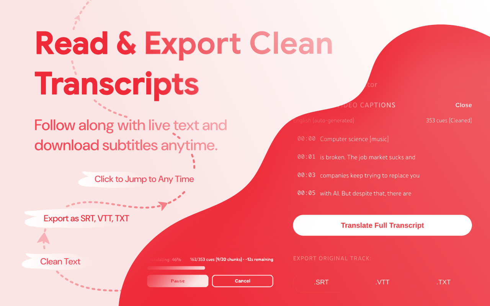

<div align="center">

  

  # LingoSub for YouTube™

  **Understand more. Learn faster. Watch without language barriers.**

  Real-time dual subtitles, instant word translations, local subtitle playback, and clean transcript exports — all integrated into your YouTube experience.

  <p>
    <a href="https://addons.mozilla.org/firefox/addon/lingosub">
      
    </a>
    <a href="https://github.com/aninduuthsara/LingoSub-for-YouTube-/issues">
      
    </a>
  </p>

  <p>
    
    
    
    
  </p>

  <br />

  

  <p>
    <a href="#features">Features</a> ·
    <a href="#preview">Preview</a> ·
    <a href="#installation">Installation</a> ·
    <a href="#keyboard--player-controls">Controls</a> ·
    <a href="#privacy">Privacy</a> ·
    <a href="#contributing">Contributing</a>
  </p>

</div>

---

## Overview

**LingoSub for YouTube™** is a browser extension that transforms YouTube into a more accessible, language-friendly learning and viewing experience.

Whether you're learning a language, watching international content, studying lectures, or reviewing educational videos, LingoSub brings useful subtitle tools directly into the video player.

Read two languages at once, explore unfamiliar words, load your own subtitle files, follow a synchronized transcript, and export clean subtitle files — without leaving the video.

> **Built for learners, viewers, and anyone who wants to understand more of what they watch.**

## Features

<table>
  <tr>
    <td width="50%" valign="top">

      ### Dual-Language Subtitles

      Display original and translated subtitles simultaneously. Customize their typography independently to make both lines easy to read.

    </td>
    <td width="50%" valign="top">

      ### Instant Word Translations

      Hover over a subtitle word to open a floating dictionary card and explore unfamiliar vocabulary without interrupting playback.

    </td>
  </tr>
  <tr>
    <td width="50%" valign="top">

      ### YouTube Caption Access

      Access available YouTube captions directly from the extension without manually downloading subtitle files.

    </td>
    <td width="50%" valign="top">

      ### Local Subtitle Playback

      Load your own `.srt` or `.vtt` file and play its subtitles in sync with a YouTube video.

    </td>
  </tr>
  <tr>
    <td width="50%" valign="top">

      ### Live Transcript

      Follow subtitle text alongside video playback. Click a timestamped cue to jump to the corresponding part of the video.

    </td>
    <td width="50%" valign="top">

      ### Clean Transcript Exports

      Export subtitle content as `.srt`, `.vtt`, or `.txt` files for study notes, language practice, and offline reference.

    </td>
  </tr>
  <tr>
    <td width="50%" valign="top">

      ### Personalized Subtitle Styling

      Adjust font size, font weight, text color, opacity, subtitle background, and vertical position to suit your preferences.

    </td>
    <td width="50%" valign="top">

      ### Integrated Player Interface

      Use a compact in-player studio designed to fit naturally into the YouTube viewing experience, with subtitle positioning and locking controls.

    </td>
  </tr>
</table>

---

## Preview

Explore LingoSub's interface and features.

<table>
  <tr>
    <td width="50%" valign="top">
      

      **In-Player Studio**

      Access subtitle tools from the video player through a compact, integrated interface.
    </td>
    <td width="50%" valign="top">
      

      **Real-Time Dual Subtitles**

      Read original and translated captions together with independent text styling.
    </td>
  </tr>
  <tr>
    <td width="50%" valign="top">
      

      **Hover Dictionary**

      Explore unfamiliar words using the floating translation interface.
    </td>
    <td width="50%" valign="top">
      

      **Caption Tools & Local Files**

      Access available video captions or load your own `.srt` and `.vtt` files.
    </td>
  </tr>
  <tr>
    <td colspan="2" align="center">
      

      **Live Transcript & Exporter**

      Follow synchronized subtitle cues and export your transcript in multiple formats.
    </td>
  </tr>
</table>

---

## Installation

### Option 1 — Install from Firefox Add-ons

The recommended installation method.

**[Install LingoSub for Firefox](https://addons.mozilla.org/firefox/addon/lingosub)**

After installation, open a YouTube video and look for the LingoSub controls in the video player.

### Option 2 — Run from Source

Test the extension directly from this repository.

**Requirements:** Mozilla Firefox and Git, or a downloaded copy of the repository.

1. Clone the repository:

   ```bash
   git clone https://github.com/aninduuthsara/LingoSub-for-YouTube-.git
   ```

2. Open Firefox and navigate to:

   ```text
   about:debugging#/runtime/this-firefox
   ```

3. Click **Load Temporary Add-on…**.
4. Select the repository's `manifest.json` file.
5. Open a YouTube video and test the extension.

> Temporary add-ons are intended for development and testing. Firefox may remove a temporarily loaded add-on when the browser restarts, so you may need to load it again.

### Chrome Support

**Coming soon.** Chrome Web Store availability has not yet been confirmed.

---

## Keyboard & Player Controls

| Action | How to use it |
| --- | --- |
| Open or close the studio | Click the LingoSub icon in the player controls or press `Esc`. |
| Change subtitle font size | Scroll the mouse wheel over the **Font Size** row to adjust the size. |
| Lock or unlock subtitles | Toggle the **Lock** control in Subtitle Styling to enable or disable dragging. |
| Translate a word | Hover over a supported subtitle word. |
| Jump to a transcript cue | Click a timestamped cue in the Live Transcript panel. |

*Note: Available controls and behavior may depend on the active player state and extension version.*

---

## Use Cases

LingoSub is designed to support a variety of everyday activities:

- **Language learning:** Compare original and translated subtitles while exploring unfamiliar vocabulary.
- **Lecture review:** Follow timestamped transcripts and revisit specific sections of a lesson.
- **International content:** Make videos in unfamiliar languages easier to follow.
- **Personal study notes:** Export subtitle content for revision and reference.
- **Custom subtitles:** Use local subtitle files when you need captions different from the ones available on YouTube.

---

## Privacy

LingoSub is designed with privacy in mind.

- **No browsing-history collection:** LingoSub states that it does not collect, track, or sell your private browsing history.
- **Open-source code:** The source code is available in this repository for inspection.
- **Direct service requests:** Translation requests connect to configured service endpoints rather than being routed through a LingoSub tracking proxy.

Some features may communicate with external services to provide their functionality. Review the source code and the relevant service policies to understand what data those requests may transmit.

---

## Support the Project

LingoSub is an independent project. Your feedback and support help guide future improvements.

<div align="center">

  <a href="https://buymeacoffee.com/aninduuthsara">
    
  </a>

</div>

### Report a Bug or Request a Feature

Found a problem or have an idea for an improvement?

- **Bug reports and feature requests:** [Open a GitHub Issue](https://github.com/aninduuthsara/LingoSub-for-YouTube-/issues)
- **In-player feedback:** Use the Developer Feedback form, when available.
- **Email:** [aninduuthsara.communexus@gmail.com](mailto:aninduuthsara.communexus@gmail.com)
- **Developer:** [Anindu Uthsara](https://github.com/aninduuthsara)

Clear reproduction steps, screenshots, and details about your browser version are especially helpful when reporting bugs.

---

## Contributing

Contributions, bug reports, and thoughtful feature suggestions are welcome.

Before submitting a pull request:

1. Check the existing issues to avoid duplicating ongoing work.
2. Describe the problem your change solves.
3. Test your changes on YouTube in Firefox.
4. Include screenshots or reproduction steps when they help explain the change.

For substantial changes, consider opening an issue first to discuss the proposed approach.

---

## License

LingoSub for YouTube™ is licensed under the **GNU General Public License v3.0 (GPL-3.0)**.

See the [`LICENSE`](LICENSE) file for the full license text.

---

## Trademark Disclaimer

YouTube™ is a trademark of Google LLC.

LingoSub for YouTube™ is an independent, open-source browser extension created by Anindu Uthsara. It is not affiliated with, endorsed by, sponsored by, or officially associated with Google LLC or YouTube.

---

<div align="center">

  **LingoSub for YouTube™**

  *Watch. Understand. Learn.*

  <sub>Built independently for a more language-friendly web.</sub>

</div>
